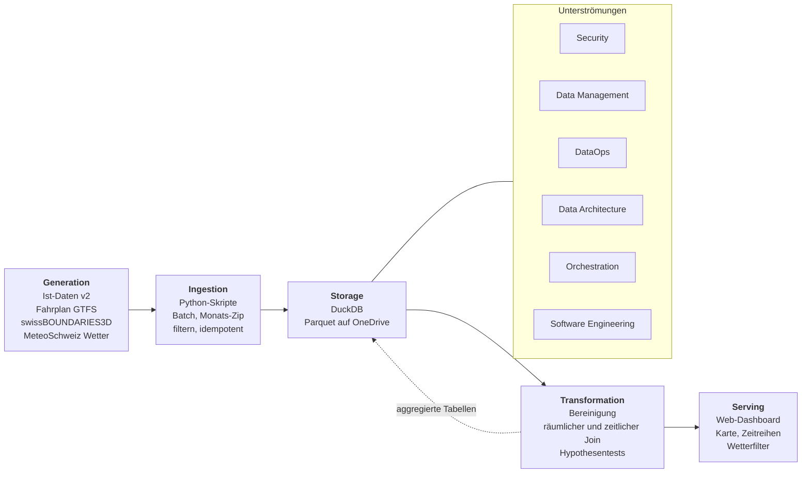

# Lifecycle-Entwurf (AP 6)

Projektarbeit Teil 1, Gruppe 4. Autor: Timon (Paket A). Stand: 25.10.2026, **Grobentwurf**. Ingestion und Storage sind von Paket B belegt (`docs/storage_evaluation.md`, `docs/quellenprofil_istdaten.md`). Die Zeilen zu Wetter und Transformation sind vorläufig, bis Paket C liefert, und mit *(vorläufig)* markiert.

Bezeichnungen der Phasen und Unterströmungen nach den Kursfolien (Reis & Housley, 2020).

## 1. Diagramm

## 2. Pro Phase: Quelle, Werkzeug, Entscheidung

| Phase | Quelle / Eingang | Werkzeug | Entscheidung und Begründung | Stand |
| --- | --- | --- | --- | --- |
| Generation | Ist-Daten v2 (opentransportdata.swiss), Fahrplan GTFS, swissBOUNDARIES3D (Kantonsgrenzen), Wetterdaten MeteoSchweiz | keine eigenen Systeme, Daten stammen aus fremden Quellsystemen | Wir besitzen die Quellsysteme nicht und kontrollieren sie nicht. Ist-Daten v2 ab Juli 2025 verfügbar, Zeitraum 1.1.–31.3.2026 vollständig abgedeckt. Fahrten ohne Echtzeitdaten fehlen in der Quelle. | belegt (Ist-Daten), Wetter *(vorläufig)* |
| Ingestion | Monatsarchiv als Zip, Tagesdateien als CSV | Python (`src/ingest_istdaten.py`, `src/build_haltestellen.py`), DuckDB | Batch statt Streaming, weil historische Daten und Archive. Tagesdatei streamend lesen, direkt auf Bahn, Bus und Ostschweizer Haltestellen filtern (sonst 35–55 GB). Idempotent: bereits geladene Tage werden übersprungen. Protokoll pro Tag in `ingest_log`. | belegt |
| Storage | gefilterte Halte, Haltestellen, Wetterstationen und -messungen | DuckDB (eine Datei), Parquet-Ordner auf OneDrive | DuckDB gegenüber SQLite, PostgreSQL und MongoDB: analytische Abfragen, CSV streamend einlesen, kein Server, sofort nachbaubar. 90 Tage Ostschweiz: 17,07 Mio. Halte, 2,6 GB, ca. 16 Min. PostgreSQL ist die nächste Stufe für Teil 2. | belegt |
| Transformation | `halt`, `haltestelle`, `wettermessung` | Python (pandas, SciPy oder statsmodels), SQL, Notebooks | Bereinigung (Plausibilitätsfenster −10 bis +60 Min., Ausfälle und Durchfahrten ausschliessen, Sommerzeit), räumlicher Join Haltestelle zu nächster Wetterstation, zeitlicher Join auf die Stunde, Hypothesentests nach `docs/konzept.md`. | *(vorläufig)*, Paket C |
| Serving | aggregierte Tabellen (pro Stunde, Linie, Verkehrsmittel, Wetterklasse) | Web-Dashboard, Technologie noch offen | Option A der Projektarbeit (Analytik, Deployment-Umgebung). Das Dashboard liest aggregierte Werte, nicht die Rohdaten. Entwurf siehe Abschnitt 4. | Entwurf, Teil 2 |

## 3. Unterströmungen im Projekt

| Unterströmung | Umsetzung im Projekt |
| --- | --- |
| Security | Nur offene Daten, keine Personendaten. Quellenangabe nach Lizenz Pflicht. Rohdaten liegen auf OneDrive und sind nur mit ZHAW-Konto zugänglich. Keine Zugangsdaten im Repo (`.env` ist ausgeschlossen). |
| Data Management | Quellenprofile (Herkunft, Lizenz, Format, Limitationen), gemeinsame Schema-Absprache (`docs/schema_absprache.md`), Datenqualität dokumentiert (Anteil gemessener Werte: Bahn 97 %, Bus 69 %), Bereinigungsregeln im Konzept festgelegt. |
| DataOps | Idempotente Ingestion, `ingest_log` mit Zeilen vor und nach dem Filter, Fehlern und Dauer. Wiederholbarer Aufbau der Datenbank mit einem Befehl. Versionierung in Git, Arbeit auf Branches. |
| Data Architecture | Batch-Architektur mit DuckDB und Parquet. Skalierbar auf mehr Kantone oder die ganze Schweiz (ca. 210 Mio. Zeilen, 34 GB hochgerechnet). Für Teil 2 ist der Wechsel auf PostgreSQL möglich. |
| Orchestration | Aktuell manuell: Skripte werden nacheinander von Hand ausgeführt (Haltestellenliste, Ist-Daten, Wetter, Transformation). Ein Scheduler ist für Teil 1 nicht nötig. Für den Ausbau wäre cron oder ein Orchestrierungswerkzeug denkbar. *(Entscheid offen)* |
| Software Engineering | Python und SQL, `requirements.txt`, kommentierter Code mit Quellen nach APA 7, Notebooks in `notebooks/`, Skripte in `src/`, Abgabe über einen eingefrorenen Branch. |

## 4. Serving: Entwurf Web-Dashboard

- **Karte:** Haltestellen der Ostschweiz, eingefärbt nach mittlerer Verspätung, filterbar nach Wetterklasse.
- **Zeitreihen:** Verspätung pro Stunde oder Tag, mit Niederschlag und Temperatur als zweite Achse.
- **Filter:** Verkehrsmittel (Bahn/Bus), Tageszeit (Hauptverkehrszeit ja/nein), Niederschlagsklasse, Kanton, Linie.
- **Kennzahlen:** Effekt von Niederschlag auf die Verspätung pro Gruppe (H1 bis H3) mit Effektstärke.
- **Datenfluss:** Transformation schreibt aggregierte Tabellen, das Dashboard liest diese. Technologie darf offen bleiben (z. B. Python-Dashboard oder SvelteKit mit PostgreSQL oder DuckDB).

## 5. Noch offen (Abgleich mit B und C)

- Von C: Wetterquelle und Auflösung (Stunden- oder 10-Minuten-Werte), Spalten von `wettermessung`, Transformationsschritte, Ablageort des bereinigten Datensatzes.
- Von B: Hinweis, ob die Parquet-Daten als eigene Schicht im Diagramm erscheinen sollen.
- Diagramm finalisieren, sobald C geliefert hat. Dann *(vorläufig)* entfernen.

## Quellen

Reis, J., & Housley, M. (2020). *Fundamentals of data engineering*. O'Reilly Media. (Phasen und Unterströmungen, nach den Kursfolien DAENG_Einfuehrung)

DuckDB Foundation. (2026). *DuckDB documentation*. https://duckdb.org/docs/
