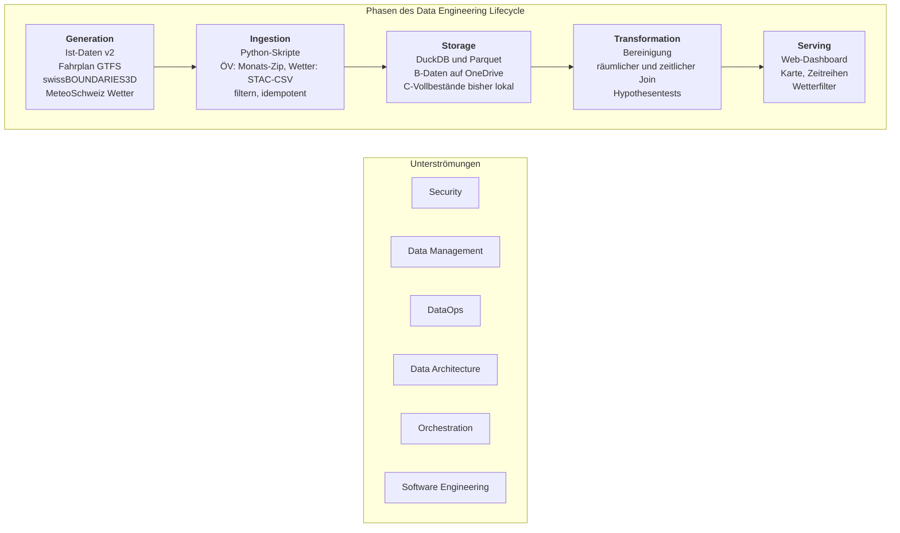

# Lifecycle-Entwurf (AP 6)

Projektarbeit Teil 1, Gruppe 4. Autor: Timon (Paket A), ergänzt um Paket C am 26.10.2026. Ingestion und Storage sind von Paket B belegt (`docs/storage_evaluation.md`, `docs/quellenprofil_istdaten.md`). Wetter und Transformation sind umgesetzt (`docs/quellenprofil_wetter.md`, `docs/transformation.md`). Serving bleibt der Entwurf für Teil 2.

Bezeichnungen der Phasen und Unterströmungen nach den Kursfolien (Reis & Housley, 2022).

## 1. Diagramm

## 2. Pro Phase: Quelle, Werkzeug, Entscheidung

| Phase | Quelle / Eingang | Werkzeug | Entscheidung und Begründung | Stand |
| --- | --- | --- | --- | --- |
| Generation | Ist-Daten v2, Fahrplan GTFS, swissBOUNDARIES3D, MeteoSchweiz SwissMetNet und swisstopo-Geländehöhen | fremde Quellsysteme | Zeitraum 1.1.–31.3.2026 abgedeckt. Wetter als fertige Stundenwerte. 13 Stationen in den vier Kantonen, 10 mit ausreichenden Kernparametern. | belegt, A/B/C |
| Ingestion | ÖV-Monatsarchiv, Wetter-Stations-CSV über STAC, GeoAdmin-Höhendienst | Python (`ingest_istdaten.py`, `build_haltestellen.py`, `ingest_wetter.py`, `build_haltestellen_hoehen.py`), DuckDB | Batch für den festen Untersuchungszeitraum. ÖV streamend filtern; Wetter auf Stations-/Stundenebene laden. Rohdateien und Höhenantworten cachen, Schlüssel verhindern Duplikate, Log pro Tag und Logfile. | belegt, B/C |
| Storage | gefilterte Halte, Haltestellen, Wetterstationen und -messungen | DuckDB (eine Datei), Parquet-Ordner auf OneDrive | DuckDB gegenüber SQLite, PostgreSQL und MongoDB: analytische Abfragen, CSV streamend einlesen, kein Server, sofort nachbaubar. 90 Tage Ostschweiz: 17,07 Mio. Halte, 2,6 GB, ca. 16 Min. PostgreSQL ist die nächste Stufe für Teil 2. | belegt |
| Transformation | `halt`, `haltestelle`, `wettermessung` | DuckDB-SQL, Python (pandas, SciPy, statsmodels), Notebooks | Nur gemessene Ankünfte, −10 bis +60 Min., Ausfälle/Durchfahrten ausschliessen. Nächste geeignete Station innerhalb 30 km/500 m Höhendifferenz. Zeitlicher Join nach Soll-Ankunft auf das Wetterintervall in UTC. 11,63 Mio. Analysehalte, H1–H3 mit Effektstärke. Ergebnis: `analyse_halt`, `analyse_stunde`, lokale Parquet-Dateien. | umgesetzt, Paket C |
| Serving | aggregierte Tabellen (pro Stunde, Linie, Verkehrsmittel, Wetterklasse) | Web-Dashboard, Technologie noch offen | Option A der Projektarbeit (Analytik, Deployment-Umgebung). Das Dashboard liest aggregierte Werte, nicht die Rohdaten. Entwurf siehe Abschnitt 4. | Entwurf, Teil 2 |

## 3. Unterströmungen im Projekt

| Unterströmung | Umsetzung im Projekt |
| --- | --- |
| Security | Nur offene Daten, keine Personendaten. Quellenangabe nach Lizenz Pflicht. Bs Daten liegen auf OneDrive mit ZHAW-Zugriff; Cs zusätzliche Vollbestände sind bisher lokal und für die externe Abgabe gepackt. Keine Zugangsdaten im Repo (`.env` ist ausgeschlossen). |
| Data Management | Quellenprofile, gemeinsame Schema-Absprache, Bereinigungs- und Join-Bilanzen. Gemessener Ankunftsstatus vor Bereinigung: Bahn 89,72 %, Bus 65,94 %; die früher genannten 97 %/69 % betreffen Abfahrten. Wetterlücken und räumliche Abdeckung sind dokumentiert. |
| DataOps | Idempotente Ingestion, `ingest_log` mit Zeilen vor und nach dem Filter, Fehlern und Dauer. Wiederholbarer Aufbau der Datenbank mit einem Befehl. Versionierung in Git, Arbeit auf Branches. |
| Data Architecture | Batch-Architektur mit DuckDB und Parquet. Skalierbar auf mehr Kantone oder die ganze Schweiz (ca. 210 Mio. Zeilen, 34 GB hochgerechnet). Für Teil 2 ist der Wechsel auf PostgreSQL möglich. |
| Orchestration | Entscheid: manuell, mit festgelegter Reihenfolge der Skripte (Haltestellenliste, Ist-Daten, Wetter, Transformation, in der README beschrieben). Ein Scheduler lohnt sich für Teil 1 nicht, weil es sich um ein einmaliges Archiv von 90 Tagen handelt und jeder Schritt wiederholbar ist (idempotent, Log pro Tag). Beim Ausbau auf aktuelle Daten oder mehr Kantone wäre cron oder ein Orchestrierungswerkzeug der nächste Schritt. |
| Software Engineering | Python und SQL, `requirements.txt`, kommentierter Code mit Quellen nach APA 7, Notebooks in `notebooks/`, Skripte in `src/`, Abgabe über einen eingefrorenen Branch. |

## 4. Serving: Entwurf Web-Dashboard

- **Karte:** Haltestellen der Ostschweiz, eingefärbt nach mittlerer Verspätung, filterbar nach Wetterklasse.
- **Zeitreihen:** Verspätung pro Stunde oder Tag, mit Niederschlag und Temperatur als zweite Achse.
- **Filter:** Verkehrsmittel (Bahn/Bus), Tageszeit (Hauptverkehrszeit ja/nein), Niederschlagsklasse, Kanton, Linie.
- **Kennzahlen:** Effekt von Niederschlag auf die Verspätung pro Gruppe (H1 bis H3) mit Effektstärke.
- **Datenfluss:** Transformation schreibt aggregierte Tabellen, das Dashboard liest diese. Technologie darf offen bleiben (z. B. Python-Dashboard oder SvelteKit mit PostgreSQL oder DuckDB).

## 5. Umsetzung Paket C und offene Abgabeablage

- Wetter-Ingestion: `src/ingest_wetter.py`; Haltestellenhöhen: `src/build_haltestellen_hoehen.py`.
- Transformation und Statistik: `src/transform.py`, `src/analyse.py`, ausgeführte Notebooks.
- Wetterspalten wie in Bs Schema, Ergebnisse lokal in DuckDB und `data/processed/`.
- Übergabe, Resultate und Folienvorlage: `docs/uebergabe_paket_c.md`.
- Noch offen für die Abgabe: Wetter-/Höhenrohdaten und bereinigte Vollbestände extern bereitstellen und Link im README ergänzen. Die vorhandene OneDrive-Ablage betrifft Bs Daten.

## Quellen

Reis, J., & Housley, M. (2022). *Fundamentals of data engineering*. O'Reilly Media.

DuckDB Foundation. (2026). *DuckDB documentation*. https://duckdb.org/docs/
