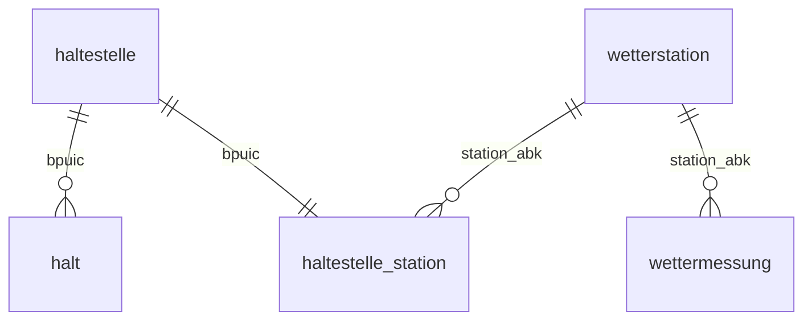

# Storage-Evaluation (Paket B, AP 4)

Stand: 20.10.2026, Entwurf. Entscheid und Begruendung fliessen in Lifecycle-Diagramm (Paket A) und Folien.

## Anforderungen aus den geplanten Abfragen

- Join ueber Zeit und Ort: jeder Halt (Haltestelle, Zeitpunkt) wird der naechsten Wetterstation und der passenden Stunde zugeordnet.
- Aggregationen pro Stunde, Linie, Verkehrsmittel, Kanton und Tageszeit (H1 bis H3).
- Datenmenge: gefiltert auf Ostschweiz, Bahn und Bus geschaetzt einige Millionen Halte fuer 90 Tage (wird nach dem ersten Tag gemessen); ungefiltert 35 bis 55 GB.
- Wiederholbarkeit: alle in der Gruppe muessen die Datenbank lokal mit einem Befehl nachbauen koennen.
- Teil 2: das Web-Dashboard liest aggregierte Werte (Karte, Zeitreihen, Wetterfilter).

## Vergleich

| Kriterium | DuckDB | SQLite | PostgreSQL | MongoDB |
| --- | --- | --- | --- | --- |
| Datenstruktur (tabellarisch, festes Schema) | sehr gut | sehr gut | sehr gut | maessig (dokumentenorientiert) |
| Analytische Abfragen (GROUP BY, Joins ueber Millionen Zeilen) | sehr gut (spaltenorientiert) | maessig (zeilenorientiert) | gut | maessig |
| CSV direkt und streamend einlesen | sehr gut (`read_csv`) | maessig | gut (`COPY`) | maessig |
| Zeitzonen (TIMESTAMPTZ, Sommerzeit) | gut | schwach (kein eigener Typ) | sehr gut | maessig |
| Skalierung auf mehr Kantone / ganze Schweiz | gut (auch direkt auf Parquet) | schwach | sehr gut | gut |
| Setup-Aufwand | sehr gering (eine Datei, `pip install`) | sehr gering | hoch (Server) | hoch (Server) |
| Mehrbenutzerbetrieb / Dashboard Teil 2 | maessig (ein Schreiber) | maessig | sehr gut | gut |
| Teamkenntnisse | SQL bekannt | SQL bekannt | SQL bekannt | wenig |

## Entscheid (Vorschlag)

**DuckDB** als Datenbank fuer Teil 1. Gruende: Die Fragestellung ist analytisch (Aggregationen und Joins ueber viele Zeilen), die Ist-Daten kommen als grosse CSV-Dateien, die DuckDB streamend und gefiltert einlesen kann, und die ganze Datenbank ist eine Datei ohne Server, also fuer alle in der Gruppe sofort nachbaubar. TIMESTAMPTZ deckt die Anforderung ISO 8601 mit Zeitzone ab.

Fuer Teil 2 ist der Wechsel auf PostgreSQL moeglich, falls das Dashboard viele gleichzeitige Zugriffe braucht; das Schema in `src/schema.sql` ist Standard-SQL und laesst sich mit wenigen Anpassungen uebertragen.

## Skalierbarkeit (gemessen am 20.10.2026)

| Umfang | Zeilen | DuckDB | Parquet (zstd) | Laufzeit |
| --- | --- | --- | --- | --- |
| 1 Tag, ganze Schweiz, Bahn und Bus | 2.34 Mio. | 375 MB | ca. 45 MB | 43 s |
| 90 Tage, Ostschweiz (TG, SG, AR, AI) | 17.07 Mio. | 2.6 GB | 305 MB | ca. 16 Min. inkl. Download |
| 90 Tage, ganze Schweiz (hochgerechnet) | ca. 210 Mio. | ca. 34 GB | ca. 4 GB | ca. 1 h |

- Die Ingestion liest jede Tagesdatei streamend; der Speicherbedarf haengt nicht von der Dateigroesse ab.
- Fuer mehr Kantone genuegt eine laengere Haltestellenliste (`src/build_haltestellen.py`, Zuordnung `KANTON_NR` um die BFS-Nummern der Kantone ergaenzen); Code und Schema bleiben gleich.
- Fuer die ganze Schweiz waere die DuckDB-Datei gross, aber machbar. Alternativ bleiben die Halte als Parquet (nach Betriebstag partitioniert) liegen und DuckDB fragt sie direkt ab (`read_parquet`), ohne sie zu kopieren.
- Grenze von DuckDB: nur ein schreibender Prozess. Fuer ein Dashboard mit vielen gleichzeitigen Zugriffen (Teil 2) ist PostgreSQL die naechste Stufe.

## Datenmodell

Tabellen siehe `src/schema.sql`: `haltestelle`, `halt` (Ist-Daten), `wetterstation`, `wettermessung`, `haltestelle_station` (Zuordnung) und `ingest_log`.

Quellen (APA 7):
DuckDB Foundation. (2026). *DuckDB documentation*. https://duckdb.org/docs/
