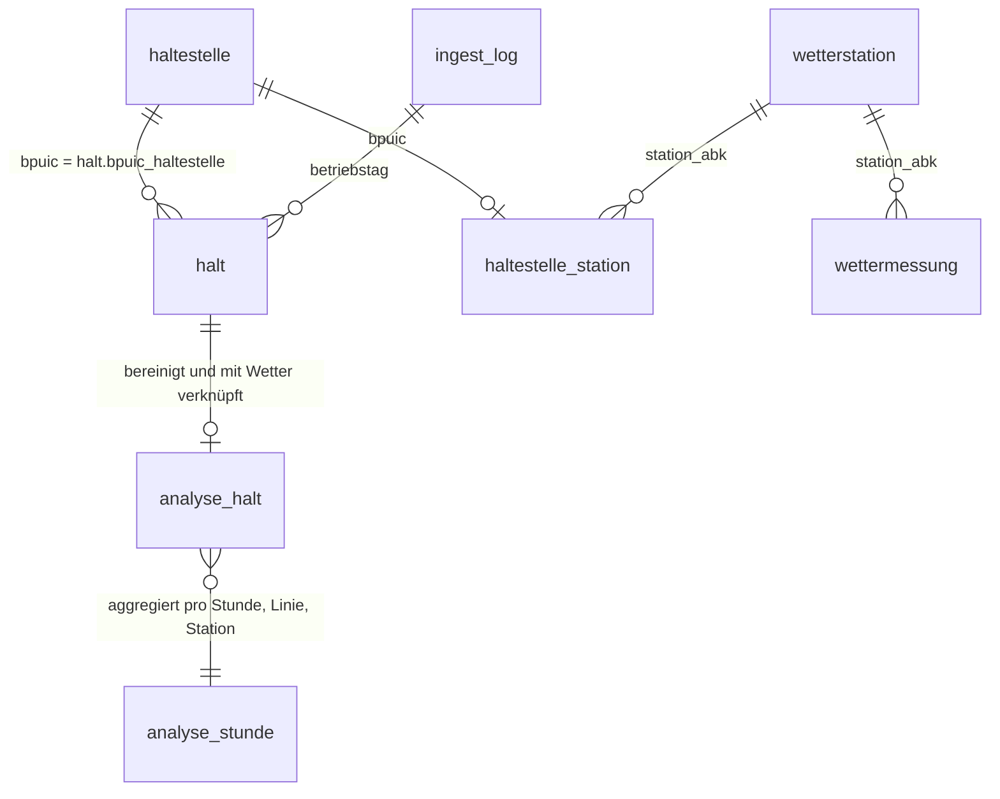

# Storage-Evaluation (Paket B, AP 4)

Stand: 27.10.2026. Entscheid und Begründung sind in Lifecycle-Diagramm (Paket A, `docs/lifecycle.md`) und Folien übernommen.

## Anforderungen aus den geplanten Abfragen

- Join über Zeit und Ort: jeder Halt (Haltestelle, Zeitpunkt) wird der nächsten Wetterstation und der passenden Stunde zugeordnet.
- Aggregationen pro Stunde, Linie, Verkehrsmittel, Kanton und Tageszeit (H1 bis H3).
- Datenmenge: gefiltert auf Ostschweiz, Bahn und Bus gemessen 17.07 Mio. Halte für 90 Tage; ungefiltert 35 bis 55 GB.
- Wiederholbarkeit: alle in der Gruppe müssen die Datenbank lokal mit einem Befehl nachbauen können.
- Teil 2: das Web-Dashboard liest aggregierte Werte (Karte, Zeitreihen, Wetterfilter).

## Vergleich

| Kriterium | DuckDB | SQLite | PostgreSQL | MongoDB |
| --- | --- | --- | --- | --- |
| Datenstruktur (tabellarisch, festes Schema) | sehr gut | sehr gut | sehr gut | mässig (dokumentenorientiert) |
| Analytische Abfragen (GROUP BY, Joins über Millionen Zeilen) | sehr gut (spaltenorientiert) | mässig (zeilenorientiert) | gut | mässig |
| CSV direkt und streamend einlesen | sehr gut (`read_csv`) | mässig | gut (`COPY`) | mässig |
| Zeitzonen (TIMESTAMPTZ, Sommerzeit) | gut | schwach (kein eigener Typ) | sehr gut | mässig |
| Skalierung auf mehr Kantone / ganze Schweiz | gut (auch direkt auf Parquet) | schwach | sehr gut | gut |
| Setup-Aufwand | sehr gering (eine Datei, `pip install`) | sehr gering | hoch (Server) | hoch (Server) |
| Mehrbenutzerbetrieb / Dashboard Teil 2 | mässig (ein Schreiber) | mässig | sehr gut | gut |
| Teamkenntnisse | SQL bekannt | SQL bekannt | SQL bekannt | wenig |

## Entscheid

**DuckDB** als Datenbank für Teil 1. Gründe: Die Fragestellung ist analytisch (Aggregationen und Joins über viele Zeilen), die Ist-Daten kommen als grosse CSV-Dateien, die DuckDB streamend und gefiltert einlesen kann, und die ganze Datenbank ist eine Datei ohne Server, also für alle in der Gruppe sofort nachbaubar. TIMESTAMPTZ deckt die Anforderung ISO 8601 mit Zeitzone ab.

Für Teil 2 ist der Wechsel auf PostgreSQL möglich, falls das Dashboard viele gleichzeitige Zugriffe braucht; das Schema in `src/schema.sql` ist Standard-SQL und lässt sich mit wenigen Anpassungen übertragen.

## Skalierbarkeit (gemessen am 20.10.2026)

| Umfang | Zeilen | DuckDB | Parquet (zstd) | Laufzeit |
| --- | --- | --- | --- | --- |
| 1 Tag, ganze Schweiz, Bahn und Bus (gemessen) | 2.34 Mio. | 375 MB | ca. 45 MB | 43 s |
| 90 Tage, Ostschweiz (TG, SG, AR, AI), Bahn und Bus (gemessen) | 17.07 Mio. | 2.6 GB | 305 MB | ca. 16 Min. inkl. Download |
| 90 Tage, ganze Schweiz, Bahn und Bus (hochgerechnet: 2.34 Mio. × 90) | ca. 210 Mio. | ca. 34 GB | ca. 4 GB | ca. 1 h |

Zum Vergleich: Die 90 Tagesdateien enthalten roh (ganze Schweiz, alle Verkehrsmittel) zusammen 215.48 Mio. Zeilen (gemessen, Summe `zeilen_roh` in `ingest_log`). Nach dem Filter (Bahn und Bus, Ostschweiz) bleiben 17.07 Mio. Halte, also rund 8 %.

- Die Ingestion liest jede Tagesdatei streamend; der Speicherbedarf hängt nicht von der Dateigrösse ab.
- Für mehr Kantone genügt eine längere Haltestellenliste (`src/build_haltestellen.py`, Zuordnung `KANTON_NR` um die BFS-Nummern der Kantone ergänzen); Code und Schema bleiben gleich.
- Für die ganze Schweiz wäre die DuckDB-Datei gross, aber machbar. Alternativ bleiben die Halte als Parquet (nach Betriebstag partitioniert) liegen und DuckDB fragt sie direkt ab (`read_parquet`), ohne sie zu kopieren.
- Grenze von DuckDB: nur ein schreibender Prozess. Für ein Dashboard mit vielen gleichzeitigen Zugriffen (Teil 2) ist PostgreSQL die nächste Stufe.

## Datenmodell

Tabellen siehe `src/schema.sql` (Paket B) und `src/transform.py` (Paket C): `haltestelle`, `halt` (Ist-Daten), `wetterstation`, `wettermessung`, `haltestelle_station` (Zuordnung), `ingest_log` sowie die Ergebnistabellen `analyse_halt` und `analyse_stunde`.

- `halt.bpuic` ist meist 9-stellig (Haltestelle und Kante). Gejoint wird über `halt.bpuic_haltestelle` (7-stellig) mit `haltestelle.bpuic`.
- `haltestelle_station` ist 0..1 pro Haltestelle: 47 Haltestellen haben keine geeignete Wetterstation innerhalb von 30 km und 500 m Höhendifferenz (`docs/ergebnisse/haltestellen_ohne_station.csv`).
- `ingest_log` hat einen Eintrag pro Quelle und Betriebstag (Status, Zeilen vor und nach dem Filter, Dauer, Filter). Die Beziehung zu `halt` läuft über den Betriebstag und ist kein Fremdschlüssel.
- `analyse_halt` enthält nur Halte, die nach der Bereinigung übrig bleiben und Wetterwerte haben (11.63 Mio.). `analyse_stunde` aggregiert sie pro Stunde, Linie, Verkehrsmittel, Kanton, Station, HVZ und starkem Niederschlag ja/nein (Grundlage für das Dashboard in Teil 2).

Quellen (APA 7):
DuckDB Foundation. (2026). *DuckDB documentation*. https://duckdb.org/docs/
